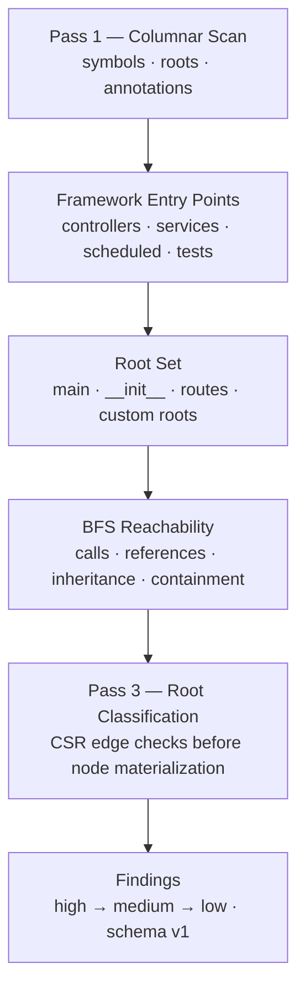

# Dead Code Detection

## Introduction

The dead-code command finds symbols that no reachable code path can ever execute. Unlike per-file linters that match names textually, rgctl answers the question **graph-wide**: it runs a reachability analysis over the whole knowledge graph from every known entry point, then reports the *roots* of each dead region.

Two properties make graph reachability a stronger signal than grep-based "unused" warnings:

1. **Framework-aware entry points.** A `main` function or a class annotated with a framework annotation (`@RestController`, `@Service`, `@MessageDriven`, JUnit `@Test`, …) is a root by construction — a helper only called from that handler is *not* dead, no matter how few textual references it has.
2. **Root-only semantics.** Downstream helpers of a dead root and isolated recursion cycles are intentionally suppressed. You get one finding per dead region (the root), not a page of noise for every transitive victim.

Every finding carries a confidence tier so you can act on **high** immediately and treat **low** (public API with no internal callers) as a review queue instead of a verdict:

| Tier | Typical findings | Meaning |
|------|------------------|---------|
| **high** | Unused imports, unreferenced non-public functions, unreferenced variables | Definite dead code |
| **medium** | Unreferenced non-public classes/structs/interfaces, unreferenced modules, type aliases | Likely dead, may be an intentional seam |
| **low** | Public functions and types with no internal callers | Possibly dead — may be an intentional API seam |

> [!NOTE]
> **Dead-code vs. Blast radius:** dead-code answers *"is anything able to reach this symbol at all?"* — a whole-graph reachability verdict per symbol. Blast-radius answers the inverse question *"if I change this symbol, how much breaks upstream?"* — impact sizing before an edit. Use dead-code to shrink, blast-radius to plan.

---

## Use Cases

- **Post-migration cleanup:** After a framework cutover or strangler-fig extraction, find helpers that only the retired entry points used to call.
- **Pre-refactor safety:** Distinguish *definitely dead* (high confidence, safe to delete) from *public API seams* (low confidence, needs a human decision) before deleting anything.
- **Reflection-heavy codebases:** JPA entities, JMS listeners, and serialization getters are invoked by containers, not by calls in your code — teach rgctl those roots with `--entry-point` instead of maintaining hand-written ignore lists.
- **CI gating:** Fail a pipeline when new high-confidence dead code appears (JSON output + `jq`).

---

## Architecture & Algorithms

`rgctl dead-code` runs `DeadCodeAnalyzer` over the mmap'd columnar snapshot (`PetGraphView` / `StructuralTopology` CSR) in three passes:



1. **Pass 1 — single columnar scan:** One zero-cold-touch pass over hot `NodeRow` columns collects analyzable symbols, language-level root candidates, and framework annotation indices. Test symbols are excluded by default (`--include-tests` re-adds them); external stubs (`file_path == "<external>"`) never produce findings.
2. **Root set:** Entry points are `main` / `__init__`, symbols annotated with a framework annotation (Spring, Jakarta/Java EE, JUnit `*Test`, Spring MVC `*Mapping`, `*Endpoint`, `@Inject`, `@Export`), nodes with outgoing `ExposesRoute` edges, and any user-supplied `--entry-point` pattern (name, qualified-name substring, or file glob).
3. **BFS reachability:** A breadth-first traversal spreads reachability across all reference edge types, so an annotated class propagates aliveness to every method it `Contains` and calls.
4. **Root classification:** Unreachable symbols *with no incoming reference edges* become findings — downstream helpers of a dead root keep their inbound edges from the dead root, so they are suppressed by design. CSR edge prechecks run before any cold node materialization, keeping large corpora fast.

---

## Step-by-Step Walkthrough

### 1. Build the Graph Snapshot

Dead-code analysis queries the pre-built snapshot. CoolStore examples use `-l java`:

```bash
rgctl -r example/coolstore discover . -l java
```

---

### 2. Run the Analysis (Text Report)

```bash
rgctl -r example/coolstore dead-code
```

**Output** (grouped by confidence tier; paths shown relative to the CoolStore checkout):

```text
Dead-code analysis: 451 total symbols, 95 reachable, 118 dead (31 entry points)

--- High confidence (79) ---
  UnreferencedFunction  CatalogItemEntity  (src/main/java/com/redhat/coolstore/model/CatalogItemEntity.java:28)  Function has no callers or references
  UnreferencedFunction  setItemId  (src/main/java/com/redhat/coolstore/model/CatalogItemEntity.java:35)  Function has no callers or references
  UnreferencedFunction  setName  (src/main/java/com/redhat/coolstore/model/CatalogItemEntity.java:43)  Function has no callers or references
  ...

--- Medium confidence (39) ---
  UnreferencedModule  com.redhat.coolstore.model  (src/main/java/com/redhat/coolstore/model/CatalogItemEntity.java:1)  Module has no imports or references from other modules
  UnreferencedClass  InventoryEntity  (src/main/java/com/redhat/coolstore/model/InventoryEntity.java:12)  Class has no references, instantiations, or extensions
  ...
```

**What this tells you:** CoolStore's JPA entity getters/setters and container-invoked listeners dominate the report — exactly the reflection-heavy symbols a textual linter cannot reason about. The next sections show how to filter and how to teach rgctl the container roots.

> [!NOTE]
> On this fixture there are no low-confidence findings: nothing flagged as dead is also marked `public` visibility. Repositories with public library-style APIs typically populate the low tier.

---

### 3. Structured JSON Output

Pass `-f json` for a schema v1 report (see the [JSON API reference](../json-api.md#22-dead-code)):

```bash
rgctl -r example/coolstore -f json dead-code | jq '.summary'
```

**Output:**

```json
{
  "total_symbols": 451,
  "reachable_symbols": 95,
  "dead_symbols": 118,
  "entry_points": 31
}
```

Each finding carries its evidence:

```bash
rgctl -r example/coolstore -f json dead-code --confidence high --limit 3 \
  | jq '.findings | map({symbol_name, kind, file_path, start_line, reason})'
```

**Output:**

```json
[
  {
    "symbol_name": "CatalogItemEntity",
    "kind": "unreferenced_function",
    "file_path": "src/main/java/com/redhat/coolstore/model/CatalogItemEntity.java",
    "start_line": 28,
    "reason": "Function has no callers or references"
  },
  {
    "symbol_name": "setItemId",
    "kind": "unreferenced_function",
    "file_path": "src/main/java/com/redhat/coolstore/model/CatalogItemEntity.java",
    "start_line": 35,
    "reason": "Function has no callers or references"
  },
  {
    "symbol_name": "setName",
    "kind": "unreferenced_function",
    "file_path": "src/main/java/com/redhat/coolstore/model/CatalogItemEntity.java",
    "start_line": 43,
    "reason": "Function has no callers or references"
  }
]
```

Findings are ordered high → medium → low confidence, then by file and line.

---

### 4. Filter by Confidence

Report only what is safe to delete without review — invalid level names exit non-zero instead of silently returning an empty report:

```bash
# High-confidence findings only — 79 of 118 on CoolStore
rgctl -r example/coolstore -f json dead-code --confidence high

# Everything except public API seams — all 118 findings here
rgctl -r example/coolstore -f json dead-code --confidence high,medium
```

---

### 5. Teach the Analyzer New Entry Points

Code invoked outside the graph — CLI subcommands, message listeners, lifecycle callbacks, reflection targets — needs an explicit root. `--entry-point` accepts a name, qualified-name substring, or file/path pattern (repeatable):

```bash
# A container-managed lifecycle listener (no callers in code)
rgctl -r example/coolstore -f json dead-code --entry-point StartupListener | jq '.summary'
```

**Output:**

```json
{
  "total_symbols": 451,
  "reachable_symbols": 107,
  "dead_symbols": 114,
  "entry_points": 39
}
```

`StartupListener` and everything it calls drop out of the findings. A file pattern roots a whole subtree at once:

```bash
# Treat every REST endpoint class as a root
rgctl -r example/coolstore -f json dead-code --entry-point rest | jq '.summary'
```

**Output:**

```json
{
  "total_symbols": 451,
  "reachable_symbols": 144,
  "dead_symbols": 110,
  "entry_points": 82
}
```

---

### 6. Scope with Excludes and Tests

```bash
# Drop the vendored WebLogic compatibility shims from the analysis
rgctl -r example/coolstore -f json dead-code --exclude weblogic | jq '.summary'
```

**Output:**

```json
{
  "total_symbols": 436,
  "reachable_symbols": 95,
  "dead_symbols": 109,
  "entry_points": 31
}
```

```bash
# Include test symbols in the analysis scope (excluded by default)
rgctl -r example/coolstore -f json dead-code --include-tests
```

`--exclude` matches path or name substrings and shell-style globs; excluded symbols neither produce findings nor count toward `total_symbols`.

---

## CLI Options

| Option | Default | Description |
|--------|---------|-------------|
| --confidence \<LEVELS\> | all levels | Comma-separated confidence filter: `high`, `medium`, `low`. Invalid names exit non-zero. |
| --entry-point \<PATTERN\> | — | Additional root pattern (name, qualified-name substring, or file/path pattern); repeatable. |
| -e, --exclude \<PATTERN\> | [] | Exclude symbols by path or name substring/glob; repeatable. |
| --include-tests | false | Include test symbols in the analysis scope (excluded by default). |
| --limit \<N\> | — | Truncate findings to the first N. |
| -f, --format | text | `text` (grouped report) or `json` (schema v1). |

---

## Working with jq

Extract actionable queues:

```bash
# Safe-delete queue: high-confidence findings grouped by kind
rgctl -r example/coolstore -f json dead-code --confidence high \
  | jq '{dead: .summary.dead_symbols, by_kind: (.findings | group_by(.kind) | map({kind: .[0].kind, count: length}))}'

# Review queue: public functions nobody calls internally
rgctl -r example/coolstore -f json dead-code --confidence low \
  | jq '.findings | map({symbol_name, loc: "\(.file_path):\(.start_line)"})'

# CI gate: fail when high-confidence dead code appears
rgctl -r . -f json dead-code --confidence high \
  | jq -e '(.findings | length) == 0' \
  || echo "new dead code introduced — see report above"
```

---

## Related Documentation

- [JSON API Reference (dead-code)](../json-api.md#22-dead-code)
- [Blast Radius Analysis](blast-radius-analysis.md) — the inverse question: upstream impact of a change
- [Clone Detection](clone-detection.md) — duplicated-code findings that often pair with dead-code cleanup
- [CLI Command Reference](cli-command-reference.md)
