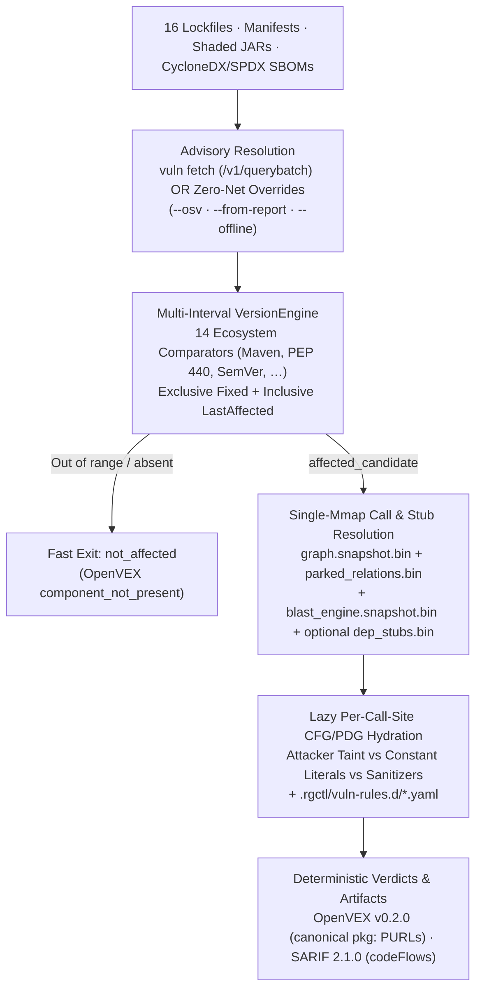

# Vulnerability Reachability, OSV Fetch & OpenVEX/SARIF

## Introduction

Traditional Software Composition Analysis (SCA) scanners compare lockfile versions against CVE feeds and flag every transitive dependency—even when the vulnerable function is never imported, never called, or invoked exclusively with compile-time constants or sanitized inputs. Worse, naive reachability tools silently suppress advisories whenever OSV metadata omits symbol names, creating dangerous false negatives.

rgctl provides an **epistemically honest, polyglot vulnerability reachability pipeline** across all 20 taint-enabled Tier-1 languages:

| Command | Purpose | Output / Formats |
|---------|---------|------------------|
| **rgctl vuln fetch** | Query live OSV (POST /v1/querybatch) for repo lockfiles and hydrate .rgctl/osv/\*.json | Summary JSON (-f json) + cached OSV v1.6 advisories |
| **rgctl vuln scan** | Single-mmap + Rayon parallel reachability across all advisories, scanner reports, or SBOMs | Batch JSON (schema_version: "1" + merged OpenVEX) or SARIF 2.1.0 (-f sarif) |
| **rgctl vuln analyze** | Deep single-advisory (or directory --osv) reachability, lazy PDG taint & OpenVEX/SARIF | VulnAnalyzeResult JSON (with canonical pkg: PURL OpenVEX) or SARIF 2.1.0 |
| **rgctl vuln triage** | Normalize OSV multi-interval ranges (Fixed & LastAffected) and SymbolCoverage | Normalized OsvTriage JSON (schema_version: 1) |
| **rgctl deps check** | Match 16 lockfile/manifest formats, SBOMs, JARs, and node_modules via 14 VersionEngines | affected_candidate or fast-exit not_affected |

---

## Use Cases

- **Eliminating Transitive Alert Fatigue:** Prove with call-graph and Program Dependence Graph (PDG) evidence that 80–90% of lockfile CVEs are either not_affected (component_not_present) or not_exploitable (vulnerable_code_not_in_execute_path / inline_mitigations_already_exist).
- **Live & Air-Gapped OSV Workflows:** Hydrate advisories directly from api.osv.dev (rgctl vuln fetch / vuln scan), or guarantee **zero outbound HTTP traffic** in air-gapped CI using --offline, --osv \<file|dir\>, --from-report \<trivy|grype|osv-scanner.json\>, and --sbom \<cdx|spdx.json\>.
- **Fail-Closed CI Security Gates:** Enforce --strict-reachability on pull requests so any under_investigation finding (such as an imported package whose CVE lacks symbol-level metadata) escalates to exploitable and blocks merge until triaged.
- **GitHub Code Scanning & VEX Pipelines:** Emit **SARIF 2.1.0** (-f sarif) with multi-step codeFlows / threadFlows (file:line caller-to-sink traces) for GitHub Security tab annotations, and **OpenVEX v0.2.0** with canonical Package URLs (pkg:maven/..., pkg:npm/..., pkg:cargo/..., pkg:pypi/...) to silence non-exploitable alerts in Trivy or Grype.
- **Wrapper SDK & Shaded JAR Stitching:** Opt into --with-dep-stubs (.rgctl/dep_stubs.bin) to scan JVM .jar/.war 0xCAFEBABE constant pools without decompilation—catching FirstPartyController → InternalAuditJar → ShadedJacksonSink chains even when META-INF/maven/pom.xml is stripped.
- **Conditional CVE Preconditions:** Codify feature-flag or configuration triggers (such as Jackson's UNWRAP_SINGLE_VALUE_ARRAYS) in .rgctl/vuln-rules.d/\*.yaml to automatically verify inline mitigations on local receivers.

---

## Architecture & How It Works



1. **Advisory & Coordinate Hydration:** vuln fetch and vuln scan collect exact locked coordinates across 16 lockfile/manifest formats (plus optional CycloneDX 1.4+ / SPDX 2.3 SBOMs), batch up to 1,000 coordinates per POST /v1/querybatch call, and cache full OSV JSON records under .rgctl/osv/. Supplying --osv, --from-report, or --offline bypasses all network I/O.
2. **Multi-Interval Ecosystem Version Matching:** Rather than collapsing multi-branch advisories into a single (introduced, fixed) pair, rgctl evaluates the full list of version intervals (supporting exclusive Fixed, inclusive LastAffected, open intervals, and versions\[\] fallback) using 14 ecosystem-native comparators (Maven, PEP 440, Cargo, Go, npm, NuGet, Composer, RubyGems, Pub, Hex, SwiftPM, Conan/vcpkg, Puppet, and LuaRocks).
3. **Single-Mmap Parallel Batch Execution:** vuln scan memory-maps graph.snapshot.bin, parked_relations.bin, and blast_engine.snapshot.bin once, then evaluates all candidate advisories concurrently on Rayon with deterministic sorting by osv_id.
4. **Lazy Per-Call-Site CPG Taint:** You do **not** need rgctl discover . --with-cfg upfront. Whenever a call site to an affected third-party sink is found, rgctl lazily builds single-function CFG/PDG on demand to distinguish attacker-controlled dataflow from constant literals and dominating sanitizers.
5. **Auditable OpenVEX & SARIF Outputs:** Every verdict maps deterministically to OpenVEX v0.2.0 (with deduplicated canonical pkg: PURLs) and SARIF 2.1.0 (codeFlows / threadFlows).

---

## Exploitability Verdicts & --strict-reachability

rgctl enforces a strict **4-state epistemic verdict matrix**—never claiming not_exploitable when an advisory lacks symbol metadata and the package is imported, or when dataflow is inconclusive:

| Exploitability Verdict | OpenVEX Status | OpenVEX Justification | Exact Condition |
|------------------------|----------------|-----------------------|-----------------|
| **not_affected** | not_affected | component_not_present | Package is absent from manifests, lockfiles, SBOM, and bundles, or all installed versions fall outside every vulnerable VersionInterval. |
| **not_exploitable** | not_affected | vulnerable_code_not_in_execute_path | Advisory has Explicit symbol coverage and 0 call sites exist in graph.snapshot.bin, parked_relations.bin, or dep_stubs.bin (or Unspecified symbol coverage with 0 package imports). |
| **not_exploitable** | not_affected | inline_mitigations_already_exist | Call sites exist, **and** every call site is proven mitigated via compile-time constant literals, dominating PDG sanitizers, or an unsatisfied rule in .rgctl/vuln-rules.d/\*.yaml. |
| **under_investigation** | under_investigation | *(omitted)* | Package is in range, **and** either (a) Unspecified symbol coverage with 1 or more package imports, or (b) sink is called with non-constant expressions where PDG taint neither proves external attacker input nor proves sanitization. |
| **exploitable** | affected | *(omitted)* | Unsanitized taint path proven from an untrusted source to the vulnerable sink (or escalated from under_investigation via --strict-reachability). |

---

## Indexing Prerequisites

This walkthrough uses **CoolStore** (example/coolstore), which bundles shaded libraries under lib/ and deserializes JMS payloads in Transformers.java. Run the full staged pipeline once (omit the positional . when passing -r):

```bash
# Recommended full pipeline (graph + CFG/PDG + taint + Universe + harmonic + semantic):
rgctl -r example/coolstore discover -l java --full

# Minimal CI index (vuln scan and vuln analyze lazily build single-function CFG/PDG per call site):
rgctl -r example/coolstore discover -l java
```

---

## Step-by-Step Walkthrough

### 1. Hydrate OSV Advisories (vuln fetch) or Use Local Overrides

On any network-connected workstation or CI runner, query api.osv.dev for every locked dependency in your repository and cache the advisories in .rgctl/osv/:

```bash
# Live OSV feed hydration (POST https://api.osv.dev/v1/querybatch)
rgctl -f json vuln fetch

# Or point at a corporate OSV mirror via flag or RGCTL_OSV_API_URL
RGCTL_OSV_API_URL="https://osv-mirror.internal" rgctl -f json vuln fetch
```

For air-gapped CI or deterministic triage against upstream scanner outputs, pass --offline, --osv \<file|dir\>, --from-report, or --sbom—**zero outbound HTTP requests are made**:

```bash
# Enrich a Trivy, Grype, or OSV-Scanner JSON report offline:
trivy fs --format json --output trivy.json .
rgctl -f json vuln scan --from-report trivy.json --offline
```

---

### 2. Run a Batch Repository Scan (vuln scan)

Scan CoolStore against a directory of OSV advisories (tests/fixtures/osv/) while inspecting shaded JARs in lib/ and transitive bytecode stubs (--with-dep-stubs):

```bash
rgctl -r example/coolstore -f json vuln scan \
  --osv tests/fixtures/osv \
  --include-jars lib \
  --with-dep-stubs
```

**JSON Output (abbreviated):**

```json
{
  "schema_version": "1",
  "command": "vuln scan",
  "counts": {
    "total": 2,
    "exploitable": 0,
    "under_investigation": 1,
    "not_exploitable": 0,
    "not_affected": 1
  },
  "results": [
    {
      "osv_id": "GHSA-jfh8-c2jp-hdp4-bench",
      "deps_verdict": "affected_candidate",
      "exploitability": "under_investigation"
    },
    {
      "osv_id": "x_RHLW-CVE-2022-34169-2.7.2.Final-rhlw-00004",
      "deps_verdict": "not_affected",
      "exploitability": "not_affected"
    }
  ],
  "openvex": {
    "@context": "https://openvex.dev/ns/v0.2.0",
    "@id": "vex:rgctl-vuln-scan",
    "author": "rgctl",
    "role": "document creator",
    "version": "1",
    "tooling": "rgctl vuln scan",
    "statements": [
      {
        "vulnerability": "GHSA-jfh8-c2jp-hdp4-bench",
        "products": [
          "pkg:maven/com.fasterxml.jackson.core/jackson-databind@2.13.5"
        ],
        "status": "under_investigation"
      },
      {
        "vulnerability": "x_RHLW-CVE-2022-34169-2.7.2.Final-rhlw-00004",
        "products": [
          "pkg:maven/xalan/serializer-bcel-6.6.1"
        ],
        "status": "not_affected",
        "justification": "component_not_present",
        "impact_statement": "Dependency not present or version not in vulnerable range."
      }
    ]
  }
}
```

Notice how vuln scan:
1. Fast-exits Xalan (CVE-2022-34169) as not_affected (component_not_present).
2. Detects jackson-databind 2.13.5 shaded inside lib/audit-logging-library-\*.jar, locates Transformers.jsonToOrder calling ObjectMapper.readValue, and emits the canonical Package URL pkg:maven/com.fasterxml.jackson.core/jackson-databind@2.13.5.

---

### 3. Enforce Fail-Closed CI Gates (--strict-reachability)

In CoolStore, Transformers.jsonToOrder(String json) is called from JMS message-driven beans (OrderServiceMDB.onMessage and InventoryNotificationMDB.onMessage). When you want CI to fail closed on any under_investigation call chain, pass --strict-reachability:

```bash
rgctl -r example/coolstore -f json vuln analyze \
  --osv tests/fixtures/osv/jackson-CVE-2022-42004.json \
  --include-jars lib \
  --strict-reachability
```

**JSON Output (key fields):**

```json
{
  "schema_version": "1",
  "osv_id": "GHSA-jfh8-c2jp-hdp4-bench",
  "deps_verdict": "affected_candidate",
  "exploitability": "exploitable",
  "sink_taint": {
    "sink": "com.fasterxml.jackson.databind.ObjectMapper.readValue",
    "sink_resolution": "resolved",
    "call_sites": [
      {
        "caller": "com.redhat.coolstore.utils.Transformers.jsonToOrder",
        "target_method": "com.fasterxml.jackson.databind.ObjectMapper.readValue",
        "file": "src/main/java/com/redhat/coolstore/utils/Transformers.java",
        "line": 81
      }
    ],
    "caller_chains": [
      {
        "from": "com.redhat.coolstore.service.OrderServiceMDB.onMessage (src/main/java/com/redhat/coolstore/service/OrderServiceMDB.java:30)",
        "to": "com.fasterxml.jackson.databind.ObjectMapper.readValue (src/main/java/com/redhat/coolstore/utils/Transformers.java:81)",
        "hops": 2
      }
    ],
    "cfg_available": true
  },
  "openvex": {
    "statements": [
      {
        "vulnerability": "GHSA-jfh8-c2jp-hdp4-bench",
        "products": [
          "pkg:maven/com.fasterxml.jackson.core/jackson-databind@2.13.5"
        ],
        "status": "affected"
      }
    ]
  }
}
```

---

### 4. Export SARIF 2.1.0 for GitHub Code Scanning (-f sarif)

Both vuln scan and vuln analyze support -f sarif, producing SARIF 2.1.0 documents with repo-relative artifactLocation.uri paths and multi-hop codeFlows / threadFlows ready for github/codeql-action/upload-sarif@v3:

```bash
rgctl -r example/coolstore -f sarif vuln scan \
  --osv tests/fixtures/osv \
  --include-jars lib \
  --strict-reachability \
  -o results.sarif
```

**SARIF 2.1.0 Output (abbreviated):**

```json
{
  "$schema": "https://raw.githubusercontent.com/oasis-tcs/sarif-spec/main/sarif-2.1/schema/sarif-schema-2.1.0.json",
  "version": "2.1.0",
  "runs": [
    {
      "tool": {
        "driver": {
          "name": "rgctl",
          "rules": [
            {
              "id": "GHSA-jfh8-c2jp-hdp4-bench",
              "shortDescription": {
                "text": "Vulnerability GHSA-jfh8-c2jp-hdp4-bench in pkg:maven/com.fasterxml.jackson.core/jackson-databind@2.13.5"
              }
            }
          ]
        }
      },
      "results": [
        {
          "ruleId": "GHSA-jfh8-c2jp-hdp4-bench",
          "level": "error",
          "locations": [
            {
              "physicalLocation": {
                "artifactLocation": {
                  "uri": "src/main/java/com/redhat/coolstore/utils/Transformers.java"
                },
                "region": { "startLine": 81 }
              }
            }
          ],
          "codeFlows": [
            {
              "threadFlows": [
                {
                  "locations": [
                    {
                      "location": {
                        "physicalLocation": {
                          "artifactLocation": {
                            "uri": "src/main/java/com/redhat/coolstore/service/OrderServiceMDB.java"
                          },
                          "region": { "startLine": 30 }
                        }
                      }
                    },
                    {
                      "location": {
                        "physicalLocation": {
                          "artifactLocation": {
                            "uri": "src/main/java/com/redhat/coolstore/utils/Transformers.java"
                          },
                          "region": { "startLine": 81 }
                        }
                      }
                    }
                  ]
                }
              ]
            }
          ]
        }
      ]
    }
  ]
}
```

---

### 5. GitHub Actions CI & Trivy VEX Integration

Combine SARIF upload for GitHub Security annotations with OpenVEX export for downstream container and filesystem scanners:

```yaml
# .github/workflows/vuln-reachability.yml
jobs:
  reachability:
    runs-on: ubuntu-latest
    permissions:
      security-events: write
      contents: read
    steps:
      - uses: actions/checkout@v4
      - name: Index repository & hydrate OSV cache
        run: |
          rgctl discover .
          rgctl -f json vuln fetch
      - name: Generate SARIF 2.1.0 & OpenVEX v0.2.0
        run: |
          rgctl -f sarif vuln scan --offline --with-dep-stubs -o results.sarif
          rgctl -f json vuln scan --offline --with-dep-stubs | jq '.openvex' > project.openvex.json
      - name: Upload reachability codeFlows to GitHub Code Scanning
        uses: github/codeql-action/upload-sarif@v3
        with:
          sarif_file: results.sarif
      - name: Run Trivy filtered by rgctl OpenVEX proofs
        run: trivy fs --vex project.openvex.json .
```

---

## Transitive Call-Stub Stitching & Conditional CVE Rules

### Stitching Wrapper Libraries (--with-dep-stubs / .rgctl/dep_stubs.bin)

First-party code frequently calls an internal wrapper SDK (AuditClient.logEvent(payload)), which in turn calls a vulnerable third-party sink (ObjectMapper.readValue(payload)). Passing --with-dep-stubs builds .rgctl/dep_stubs.bin:

- **Zero-decompile JVM .jar / .war .class scanner:** Parses 0xCAFEBABE constant pools and Code attribute invoke instructions (invokevirtual, invokespecial, invokestatic, invokeinterface)—even on Gradle or shaded JARs without META-INF/maven/pom.xml.
- **Lockfile-scoped vendor/cache source stubs:** Extracts lightweight caller → callee edges from opted-in --include-node-modules, vendor/, and .venv/ trees across JS/TS, Python, Ruby, PHP, Go, and Rust.

### Declarative Conditional CVE Rules (.rgctl/vuln-rules.d/\*.yaml)

Many CVEs are reachable **only** when a non-default feature flag is enabled. Define declarative preconditions in {repo}/.rgctl/vuln-rules.d/\*.yaml:

```yaml
# .rgctl/vuln-rules.d/jackson.yaml
rules:
  - id: jackson-unwrap-single-value-arrays
    advisories:
      - CVE-2022-42004
      - GHSA-jfh8-c2jp-hdp4-bench
    package: com.fasterxml.jackson.core:jackson-databind
    required_patterns:
      - UNWRAP_SINGLE_VALUE_ARRAYS
    missing_verdict: not_exploitable
    reason: "CVE-2022-42004 requires DeserializationFeature.UNWRAP_SINGLE_VALUE_ARRAYS enabled on ObjectMapper"
```

- When ObjectMapper is constructed locally in the file and UNWRAP_SINGLE_VALUE_ARRAYS is absent, rgctl downgrades the finding to not_exploitable (inline_mitigations_already_exist).
- When the receiver is injected via constructor or method parameters so external configuration cannot be ruled out locally, rgctl conservatively keeps under_investigation (or exploitable under --strict-reachability).

---

## Tier-1 Ecosystem, Lockfile & VersionEngine Matrix

rgctl supports end-to-end vulnerability reachability across **all 20 taint-enabled Tier-1 languages**, backed by **16 lockfile/manifest formats** and **14 ecosystem-native VersionEngine comparators**:

| Language(s) | Ecosystem | Manifests & Lockfiles Scanned | VersionEngine Semantics | OSV Symbol Conventions |
|-------------|-----------|-------------------------------|-------------------------|------------------------|
| **Java, Kotlin, Groovy, Scala** | Maven | pom.xml (\<properties\> & \<parent\> interpolation), build.gradle(.kts), gradle.lockfile, --include-jars | Maven qualifier ordering (alpha \< beta \< milestone \< rc \< snapshot \< GA \< sp) | affected_methods, affected_classes, symbols |
| **Rust** | crates.io | Cargo.toml, Cargo.lock | Cargo SemVer 2.0 | RustSec affects.functions, affected_methods |
| **Go** | Go | go.mod, go.sum | Go v-prefixed SemVer + pseudo-versions | imports\[\].symbols, affected_methods |
| **TypeScript, JavaScript** | npm | package.json, package-lock.json (v1/v2/v3), pnpm-lock.yaml (v5/v6/v9), yarn.lock (v1/Berry), --include-node-modules | npm SemVer | affected_methods, symbols, imports\[\].symbols |
| **Python** | PyPI | uv.lock, poetry.lock, Pipfile.lock, pinned requirements.txt | Full **PEP 440** (epoch!, dev \< a/b/rc \< release \< post) | affected_methods, symbols, affects.functions |
| **C#** | NuGet | packages.lock.json | NuGet case-insensitive 4-part SemVer | affected_methods, symbols |
| **PHP** | Packagist | composer.lock | Composer normalized versions (v-strip, patch/pl/p) | affected_methods, symbols |
| **Ruby, ERB** | RubyGems | Gemfile.lock | Gem::Version numeric-vs-prerelease segment ordering | affected_methods, symbols |
| **Dart** | Pub | pubspec.lock | Pub SemVer (+build metadata ignored for precedence) | affected_methods, symbols |
| **Elixir** | Hex | mix.lock | Hex SemVer | affected_methods, symbols |
| **Swift** | SwiftURL | Package.resolved (v1 & v2) | SwiftPM SemVer | affected_methods, symbols |
| **C, C++** | Conan / vcpkg | conan.lock (v1/v2), vcpkg.json (dependencies + overrides) | Conan / vcpkg version + #port-version ordering | affected_methods, symbols |
| **Puppet** | Puppet | Puppetfile.lock | Puppet Forge SemVer | affected_methods, symbols |
| **Lua** | LuaRocks | \*.rockspec (dependencies + package) | LuaRocks version + -rev ordering | affected_methods, symbols |
| **Bash** | OS / SBOM | Pair with --sbom \<cdx\|spdx.json\> or --from-report | Via SBOM PURL ecosystem | Taint & command calls supported; no native lockfile |
| **SQL, HCL, Markdown** | — | Structural / DSL only | — | Non-package plugins (structural-only honesty) |

---

## CLI Flag Reference

### vuln fetch Options

| Flag | Default | Description |
|------|---------|-------------|
| --osv-api-url \<URL\> | RGCTL_OSV_API_URL or https://api.osv.dev | Base OSV HTTP endpoint (POST /v1/querybatch + GET /v1/vulns/{id}). |
| --sbom \<PATH\> | — | Merge CycloneDX 1.4+ or SPDX 2.3 JSON SBOM components before querying OSV. |
| --include-jars \<DIR\> | [] | Include shaded/bundled .jar/.war coordinates in the OSV query batch. |
| --include-node-modules \<DIR\> | [] | Include node_modules/ package coordinates in the OSV query batch. |

### vuln scan Options

| Flag | Default | Description |
|------|---------|-------------|
| --osv \<FILE\|DIR\> | — | Local OSV JSON file or directory override (zero network traffic). |
| --from-report \<PATH\> | — | Local Trivy, Grype, or OSV-Scanner JSON report override (zero network traffic). |
| --sbom \<PATH\> | — | Merge CycloneDX or SPDX JSON SBOM coordinates into dependency resolution. |
| --offline | false | Read cached .rgctl/osv/\*.json only; forbid outbound HTTP requests. |
| --osv-api-url \<URL\> | RGCTL_OSV_API_URL or https://api.osv.dev | Custom OSV API URL when auto-hydrating online. |
| --strict-reachability | false | Escalate under_investigation verdicts to exploitable (Status::Affected). |
| --with-dep-stubs | false | Build/load .rgctl/dep_stubs.bin to stitch transitive JAR/vendor call chains. |
| --include-jars \<DIR\> | [] | Directories containing bundled .jar/.war archives. |
| --include-node-modules \<DIR\> | [] | Directories containing node_modules/ trees. |
| -f, --format \<FMT\> | text | Output format: text, json (VulnScanResult + OpenVEX), or sarif (SARIF 2.1.0). |

### vuln analyze Options

| Flag | Default | Description |
|------|---------|-------------|
| --osv \<FILE\|DIR\> | Required (unless --from-report) | Single OSV JSON file or directory of OSV JSON files (zero network traffic). |
| --from-report \<PATH\> | — | Evaluate advisories extracted from a Trivy, Grype, or OSV-Scanner JSON report. |
| --sbom \<PATH\> | — | Merge CycloneDX or SPDX JSON SBOM coordinates into deps check. |
| --strict-reachability | false | Escalate under_investigation verdicts to exploitable (Status::Affected). |
| --with-dep-stubs | false | Build/load .rgctl/dep_stubs.bin for transitive wrapper call stitching. |
| --include-jars \<DIR\> | [] | Directories containing bundled .jar/.war archives. |
| --include-node-modules \<DIR\> | [] | Directories containing node_modules/ trees. |
| -f, --format \<FMT\> | text | Output format: text, json, or sarif (SARIF 2.1.0). |

---

## Working with jq

```bash
# 1. Summarize repo-wide reachability counts and exploitable CVEs
rgctl -f json vuln scan --offline \
  | jq '{counts, exploitable: [.results[] | select(.exploitability == "exploitable") | .osv_id]}'

# 2. Extract standalone OpenVEX v0.2.0 document with canonical pkg: PURLs
rgctl -f json vuln scan --offline | jq '.openvex' > project.openvex.json

# 3. Fail CI if any CVE is exploitable under strict reachability
rgctl -f json vuln scan --offline --strict-reachability \
  | jq -e '.counts.exploitable == 0'

# 4. List exact file:line call sites hitting vulnerable sinks across all advisories
rgctl -f json vuln scan --offline \
  | jq '[.results[] | {osv_id, sites: (.sink_taint.call_sites // [])}] | map(select((.sites | length) > 0))'
```

---

## Related Documentation

- [Vulnerability and OSV Supply-Chain Analysis](vulnerability-and-osv-analysis.md) — single-advisory pipeline fundamentals and custom YAML taint rules
- [CLI Command Reference](cli-command-reference.md) — full Security & Vulnerability command flag reference
- [Agent Pack Guide](agent-skill.md) — run **/rgctl:vuln** (rgctl-vuln skill) for automated agent CVE triage reports
- [Program Slicing Guide](program-slicing.md) — inspect statement-level backward/forward PDG slices around sink call sites
- [Blast Radius Analysis Guide](blast-radius-analysis.md) — upstream caller impact and attack-boundary classification
- [JSON API Reference: vuln and security](../json-api.md#12b-vuln-fetch--vuln-scan--sarif-210)
