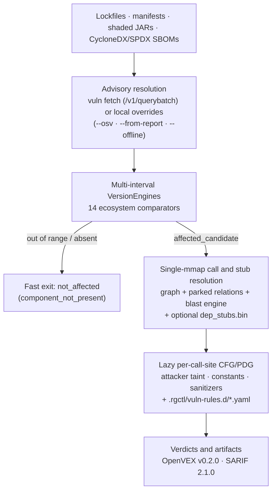

# Batch Vulnerability Scanning, OSV Fetch & SARIF

## Scope

This guide covers **whole-repository and CI** vulnerability workflows:

- hydrate OSV advisories for every locked dependency (`vuln fetch`)
- scan the repository with one evidence pass per advisory (`vuln scan`)
- enforce fail-closed gates (`--strict-reachability`)
- emit SARIF 2.1.0 and OpenVEX for GitHub Code Scanning and Trivy/Grype
- stitch transitive JAR and vendor call chains (`--with-dep-stubs`)
- apply conditional CVE rules from `.rgctl/vuln-rules.d/`

For a single advisory — triage, dependency match, call sites, attack boundaries, taint, and a detailed OpenVEX statement — use [Single-Advisory Vulnerability Reachability](vulnerability-and-osv-analysis.md).

## Shared Concepts

The verdict model and indexing prerequisites are shared by both workflows. To avoid drift, they live in the single-advisory guide:

- [Exploitability verdicts](vulnerability-and-osv-analysis.md) — `not_affected`, `not_exploitable`, `under_investigation`, `exploitable`, and their OpenVEX justifications.
- [Indexing prerequisites](vulnerability-and-osv-analysis.md) — `discover`, lazy CFG/PDG, and standalone taint requirements.
- [Sink-first taint](vulnerability-and-osv-analysis.md) — `taint` and declarative taint rules.

The batch commands use the same verdicts. `vuln scan` reports one verdict per advisory and aggregates them in `counts`.

## How Batch Scanning Works



1. **Hydrate coordinates.** `vuln fetch` and `vuln scan` collect locked coordinates from manifests and lockfiles, plus optional JARs, `node_modules`, and SBOMs. They batch up to 1,000 coordinates per `POST /v1/querybatch` and cache full OSV records under `.rgctl/osv/`.
2. **Match ranges.** Multi-interval ranges are evaluated with 14 ecosystem-native comparators, including exclusive `fixed`, inclusive `last_affected`, open intervals, and `versions[]` fallback.
3. **Scan the graph.** `vuln scan` memory-maps the snapshots once and evaluates advisories in parallel, with deterministic ordering by `osv_id`.
4. **Hydrate only what is needed.** `vuln scan` and `vuln analyze` build single-function CFG/PDG lazily for call sites; `discover --with-cfg` is not required up front.
5. **Emit artifacts.** Every result carries OpenVEX v0.2.0 statements; the batch envelope merges them. `-f sarif` emits SARIF 2.1.0 with code flows when call sites exist.

## Before You Scan

```bash
rgctl -r example/coolstore-weblogic discover -l java
```

That is enough for `vuln scan` and `vuln analyze`; both hydrate per-call-site CFG/PDG lazily. For standalone `rgctl taint --sink`, run `discover --with-cfg --with-taint`; see the [single-advisory prerequisites](vulnerability-and-osv-analysis.md).

The examples use the in-tree CoolStore fixture, fetched by `scripts/fetch-profile-repos.sh` into `example/coolstore-weblogic`. Substitute your repository path.

## Step-by-Step Walkthrough

### 1. Hydrate OSV Advisories (`vuln fetch`)

```bash
# Query api.osv.dev for every locked dependency and cache advisories.
rgctl -f json vuln fetch

# Corporate OSV mirror:
RGCTL_OSV_API_URL="https://osv-mirror.internal" rgctl -f json vuln fetch
# or: rgctl -f json vuln fetch --osv-api-url https://osv-mirror.internal
```

The JSON summary reports the API base, output directory, queried package count, matched advisory IDs, and cached files. `vuln fetch` writes one OSV JSON file per advisory under `.rgctl/osv/`.

For air-gapped CI, skip `vuln fetch` and use a local override:

```bash
# Enrich an upstream Trivy, Grype, or OSV-Scanner report offline.
rgctl -f json vuln scan --from-report trivy.json --offline
```

`--osv`, `--from-report`, `--sbom` with `--offline`, and an existing `.rgctl/osv/` cache avoid outbound HTTP. `--offline` never fetches.

### 2. Scan the Repository (`vuln scan`)

```bash
rgctl -r example/coolstore-weblogic -f json vuln scan \
  --osv tests/fixtures/osv \
  --include-jars lib \
  --with-dep-stubs
```

The CoolStore build bundles `jackson-databind@2.13.5` inside `lib/audit-logging-library-*.jar`; `--include-jars lib` includes it in the inventory. `--with-dep-stubs` builds `.rgctl/dep_stubs.bin` and attempts to stitch transitive wrapper calls.

Actual output for this fixture (abbreviated):

```json
{
  "schema_version": "1",
  "command": "vuln scan",
  "counts": {
    "total": 2,
    "exploitable": 0,
    "under_investigation": 0,
    "not_exploitable": 1,
    "not_affected": 1
  },
  "results": [
    {
      "schema_version": "1",
      "osv_id": "GHSA-jfh8-c2jp-hdp4-bench",
      "deps_verdict": "affected_candidate",
      "exploitability": "not_exploitable",
      "phases": ["triage", "deps_check", "package_query", "affected_method_callers", "sink_first_taint"],
      "notes": "sink_resolution=unresolved; exploitability grounded in zero affected-method callers, not empty taint paths alone"
    },
    {
      "schema_version": "1",
      "osv_id": "x_RHLW-CVE-2022-34169-2.7.2.Final-rhlw-00004",
      "deps_verdict": "not_affected",
      "exploitability": "not_affected",
      "phases": ["triage", "deps_check"],
      "notes": "Early exit after deps check"
    }
  ],
  "openvex": {
    "@context": "https://openvex.dev/ns/v0.2.0",
    "@id": "vex:batch:2",
    "author": "rgctl",
    "role": "document creator",
    "version": "1",
    "tooling": "rgctl vuln scan",
    "statements": [
      { "vulnerability": "GHSA-jfh8-c2jp-hdp4-bench", "products": ["pkg:maven/com.fasterxml.jackson.core/jackson-databind@2.13.5"], "status": "not_affected", "justification": "vulnerable_code_not_in_execute_path" },
      { "vulnerability": "x_RHLW-CVE-2022-34169-2.7.2.Final-rhlw-00004", "products": ["pkg:maven/xalan/serializer-bcel-6.6.1"], "status": "not_affected", "justification": "component_not_present" }
    ]
  }
}
```

Two results are worth reading carefully:

- **Xalan** is `not_affected`: the dependency is absent or outside the vulnerable range.
- **Jackson** is `not_exploitable`: the shaded JAR declares `jackson-databind@2.13.5`, but the application does not call `ObjectMapper.readValue`. `Transformers.jsonToOrder` uses `jakarta.json`, and `--with-dep-stubs` does not find a first-party path to the Jackson sink. The sink is unresolved in indexed source, which is why the note explicitly says empty taint paths alone are not proof.

That is the honest outcome for this fixture. It is not evidence that the shaded JAR is safe in every application; it is evidence that this application does not reach the sink.

### 3. Fail-Closed CI Gates (`--strict-reachability`)

```bash
rgctl -r example/coolstore-weblogic -f json vuln scan \
  --osv tests/fixtures/osv \
  --include-jars lib \
  --with-dep-stubs \
  --strict-reachability
```

`--strict-reachability` escalates **`under_investigation`** findings to `exploitable`. It does not change `not_affected` or `not_exploitable`; in the CoolStore fixture the Jackson verdict remains `not_exploitable`.

Use it when “inconclusive but reachable” should block a merge. Do not use it as a substitute for resolving the sink; the note and `sink_resolution` still matter.

### 4. Export SARIF 2.1.0 (`-f sarif`)

```bash
rgctl -r example/coolstore-weblogic -f sarif vuln scan \
  --osv tests/fixtures/osv \
  --include-jars lib \
  --strict-reachability \
  -o results.sarif
```

`vuln scan` emits SARIF 2.1.0. When a call site is reachable, results carry repo-relative `artifactLocation.uri` paths and `codeFlows` / `threadFlows` for the caller-to-sink trace:

```json
{
  "$schema": "https://raw.githubusercontent.com/oasis-tcs/sarif-spec/master/Schemata/sarif-schema-2.1.0.json",
  "version": "2.1.0",
  "runs": [
    {
      "tool": { "driver": { "name": "rgctl" } },
      "results": [
        {
          "ruleId": "GHSA-example",
          "level": "error",
          "locations": [
            {
              "physicalLocation": {
                "artifactLocation": { "uri": "src/main/java/com/example/Sink.java" },
                "region": { "startLine": 42 }
              }
            }
          ],
          "codeFlows": [
            {
              "threadFlows": [
                {
                  "locations": [
                    { "location": { "physicalLocation": { "artifactLocation": { "uri": "src/main/java/com/example/Entry.java" }, "region": { "startLine": 12 } } } },
                    { "location": { "physicalLocation": { "artifactLocation": { "uri": "src/main/java/com/example/Sink.java" }, "region": { "startLine": 42 } } } }
                  ]
                }
              ]
            }
          ]
        }
      ]
    }
  ]
}
```

The shape above is an **exploitable** finding. A `not_exploitable` result has `level: "none"` and typically no `codeFlows`; that is the expected CoolStore output, not a malformed SARIF file.

### 5. GitHub Actions and Trivy VEX

```yaml
# .github/workflows/vuln-reachability.yml
jobs:
  reachability:
    runs-on: ubuntu-latest
    permissions:
      security-events: write
      contents: read
    steps:
      - uses: actions/checkout@v4
      - name: Index the repository and hydrate OSV
        run: |
          rgctl discover .
          rgctl -f json vuln fetch --include-jars lib
      - name: Generate SARIF and OpenVEX
        run: |
          rgctl -f sarif vuln scan --offline --include-jars lib --with-dep-stubs -o results.sarif
          rgctl -f json vuln scan --offline --include-jars lib --with-dep-stubs | jq '.openvex' > project.openvex.json
      - name: Upload code flows to GitHub Code Scanning
        uses: github/codeql-action/upload-sarif@v3
        with:
          sarif_file: results.sarif
      - name: Run Trivy with rgctl VEX proofs
        run: trivy fs --vex project.openvex.json .
```

`--offline` reads the cache populated by `vuln fetch`. Keep `--include-jars`/`--include-node-modules` consistent between the fetch and scan steps if you rely on bundled dependencies.

## Transitive Call Stubs (`--with-dep-stubs`)

Passing `--with-dep-stubs` to `vuln scan` or `vuln analyze` builds `.rgctl/dep_stubs.bin`:

- **JVM bytecode:** parses `0xCAFEBABE` constant pools and `Code` attribute `invokevirtual` / `invokespecial` / `invokestatic` / `invokeinterface` instructions. It works on shaded or Gradle-built JARs even when `META-INF/maven/pom.xml` is absent.
- **Vendor source:** extracts lightweight caller → callee edges from opted-in `node_modules`, `vendor`, and `.venv` trees across JS/TS, Python, Ruby, PHP, Go, and Rust.
- **Stitching:** connects first-party `parked_relations.bin` call sites to transitive vulnerable sinks through the wrapper chain.

This narrows the gap between “the dependency is bundled” and “the application can reach the vulnerable method.”

## Conditional CVE Rules (`.rgctl/vuln-rules.d/`)

Some advisories are only exploitable when a feature flag or configuration is enabled. Declare the trigger in `.rgctl/vuln-rules.d/*.yaml`:

```yaml
# .rgctl/vuln-rules.d/jackson.yaml
rules:
  - id: jackson-unwrap-single-value-arrays
    advisories:
      - CVE-2022-42004
      - GHSA-jfh8-c2jp-hdp4-bench
    package: com.fasterxml.jackson.core:jackson-databind
    required_patterns:
      - UNWRAP_SINGLE_VALUE_ARRAYS
    missing_verdict: not_exploitable
    reason: "CVE-2022-42004 requires DeserializationFeature.UNWRAP_SINGLE_VALUE_ARRAYS enabled on ObjectMapper"
```

- If the trigger is absent from a local call-site slice, the finding is downgraded to `not_exploitable` with `inline_mitigations_already_exist`.
- If the receiver escapes local analysis (for example, an injected `ObjectMapper` configured elsewhere), the finding stays `under_investigation`, or becomes `exploitable` under `--strict-reachability`.

These are **trigger rules** for CVE preconditions, not taint source/sink rules. Taint rules belong to `discover --taint-rules`; see [Declarative taint rules](vulnerability-and-osv-analysis.md).

## Ecosystem, Lockfile & VersionEngine Coverage

Batch reachability covers the 20 taint-enabled Tier-1 languages, with 14 ecosystem-native `VersionEngine` comparators across the lockfile and manifest adapters below.

| Language(s) | Ecosystem | Manifests & lockfiles | Version semantics |
|---|---|---|---|
| **Java, Kotlin, Groovy, Scala** | Maven | `pom.xml`, `build.gradle(.kts)`, `gradle.lockfile`, `--include-jars` | Maven qualifier ordering |
| **Rust** | crates.io | `Cargo.toml`, `Cargo.lock` | Cargo SemVer 2.0 |
| **Go** | Go | `go.mod`, `go.sum` | Go v-prefixed SemVer + pseudo-versions |
| **TypeScript, JavaScript** | npm | `package.json`, `package-lock.json` (v1/v2/v3), `pnpm-lock.yaml`, `yarn.lock` (v1/Berry), `--include-node-modules` | npm SemVer |
| **Python** | PyPI | `uv.lock`, `poetry.lock`, `Pipfile.lock`, pinned `requirements.txt` | PEP 440 |
| **C#** | NuGet | `packages.lock.json` | NuGet case-insensitive 4-part SemVer |
| **PHP** | Packagist | `composer.lock` | Composer normalized versions |
| **Ruby, ERB** | RubyGems | `Gemfile.lock` | Gem::Version ordering |
| **Dart** | Pub | `pubspec.lock` | Pub SemVer |
| **Elixir** | Hex | `mix.lock` | Hex SemVer |
| **Swift** | SwiftURL | `Package.resolved` (v1 & v2) | SwiftPM SemVer |
| **C, C++** | Conan / vcpkg | `conan.lock`, `vcpkg.json` | Conan / vcpkg ordering |
| **Puppet** | Puppet Forge | `Puppetfile.lock` | Forge SemVer |
| **Lua** | LuaRocks | `*.rockspec` | LuaRocks version + revision |
| **Bash** | OS / SBOM | `--sbom`, `--from-report` | PURL ecosystem |
| **SQL, HCL, Markdown** | — | Structural / DSL only | — |

OSV symbol conventions vary by ecosystem (`affected_methods`, `symbols`, `imports[].symbols`, RustSec `functions`); rgctl normalizes them into the same `symbol_coverage` and affected-method fields used by both guides.

## CLI Flag Reference

Full schemas and flags live in the [JSON API reference](../json-api.md) and [CLI command reference](cli-command-reference.md). This guide owns `vuln fetch` and `vuln scan`; `triage`, `deps check`, `analyze`, and `taint` are documented in the [single-advisory guide](vulnerability-and-osv-analysis.md).

### `vuln fetch`

| Flag | Default | Description |
|---|---|---|
| `--osv-api-url <URL>` | `$RGCTL_OSV_API_URL` or `https://api.osv.dev` | OSV API base URL. |
| `--output-dir <DIR>` | `<repo>/.rgctl/osv` | Directory for cached OSV JSON files. |
| `--include-jars <DIR>` | — | Include bundled JAR/WAR coordinates in the query. |
| `--include-node-modules <DIR>` | — | Include `node_modules` coordinates in the query. |
| `--sbom <PATH>` | — | Merge CycloneDX or SPDX components into the query. |
| `--timeout-secs <N>` | `15` | HTTP timeout. |

### `vuln scan`

| Flag | Default | Description |
|---|---|---|
| `--osv <FILE\|DIR>` | — | Local OSV file/directory override; no network. |
| `--from-report <PATH>` | — | Trivy, Grype, or OSV-Scanner JSON override. |
| `--sbom <PATH>` | — | Merge CycloneDX/SPDX coordinates. |
| `--offline` | `false` | Use `.rgctl/osv/` cache only; no network. |
| `--osv-api-url <URL>` | `$RGCTL_OSV_API_URL` or `https://api.osv.dev` | OSV API base URL when hydrating online. |
| `--include-jars <DIR>` | — | Include bundled JAR/WAR archives. |
| `--include-node-modules <DIR>` | — | Include `node_modules` trees. |
| `--with-dep-stubs` | `false` | Build/use `.rgctl/dep_stubs.bin`. |
| `--strict-reachability` | `false` | Escalate `under_investigation` to `exploitable`. |
| `-f, --format text\|json\|sarif` | `text` | Output format. |

## Working with `jq`

```bash
# Counts and exploitable advisory IDs
rgctl -f json vuln scan --offline \
  | jq '{counts, exploitable: [.results[] | select(.exploitability == "exploitable") | .osv_id]}'

# Standalone OpenVEX document
rgctl -f json vuln scan --offline | jq '.openvex' > project.openvex.json

# File/line call sites across all advisories
rgctl -f json vuln scan --offline \
  | jq '[.results[] | {osv_id, sites: (.sink_taint.call_sites // [])}] | map(select((.sites | length) > 0))'

# Verdict distribution
rgctl -f json vuln scan --offline | jq '.counts'
```

## Related Documentation

- [Single-Advisory Vulnerability Reachability](vulnerability-and-osv-analysis.md) — triage, dependency matching, callers, taint, and detailed OpenVEX.
- [JSON API Reference](../json-api.md) — output schemas and complete flag lists.
- [CLI Command Reference](cli-command-reference.md) — command overview.
- [Agent pack](agent-skill.md) — automated `/rgctl:vuln` triage reports.
- [Program Slicing](program-slicing.md) — statement-level slices around sink call sites.
- [Blast Radius Analysis](blast-radius-analysis.md) — upstream caller impact and boundary classification.
- [CI Policy Checks](ci-policy-checks.md) — temporal PR gates alongside vulnerability gates.
